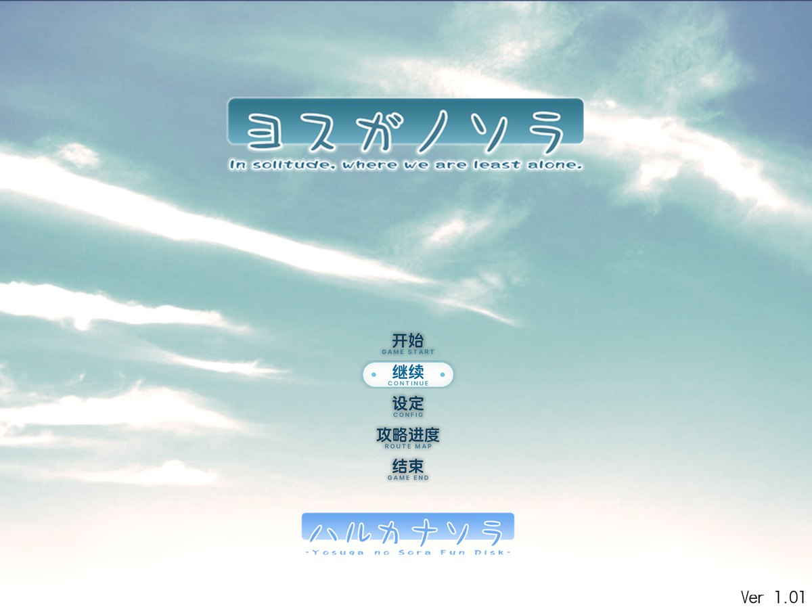
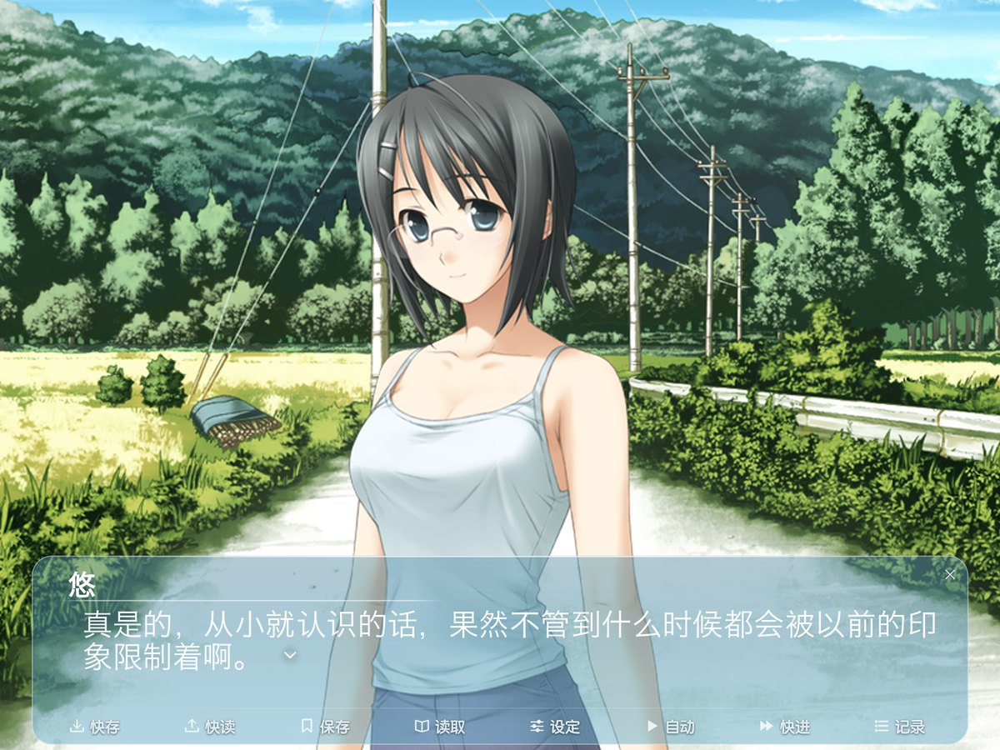
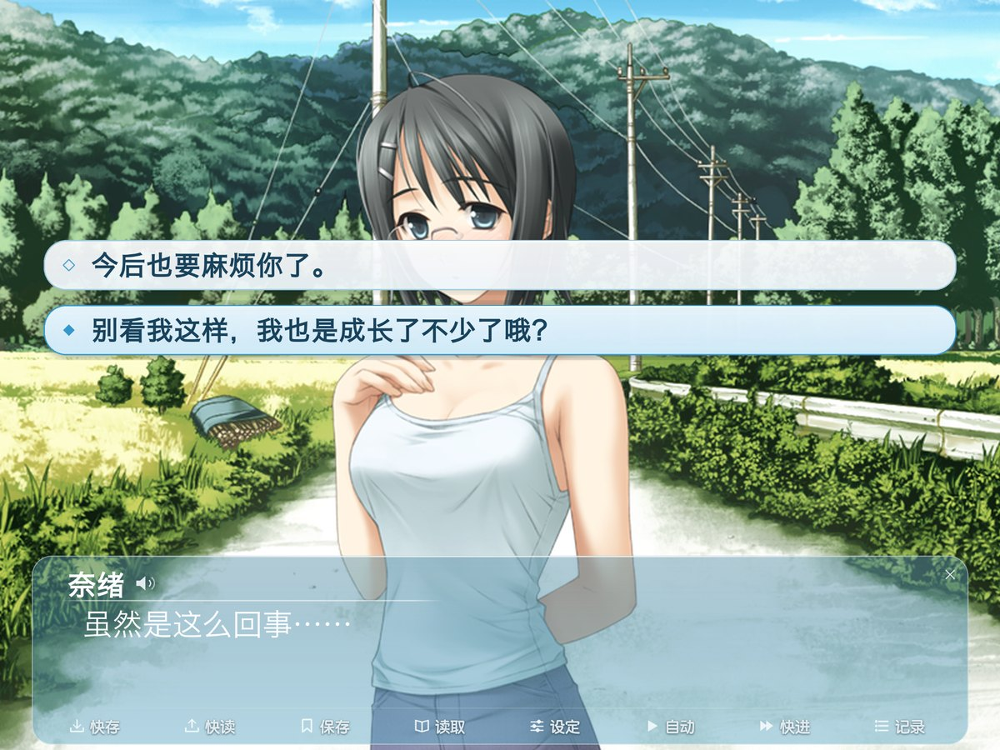
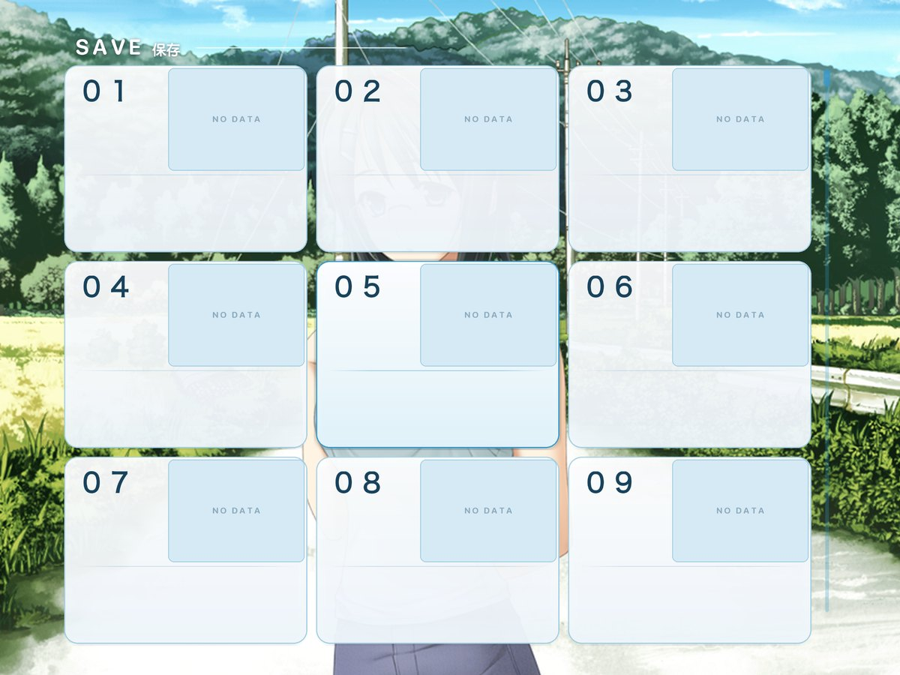
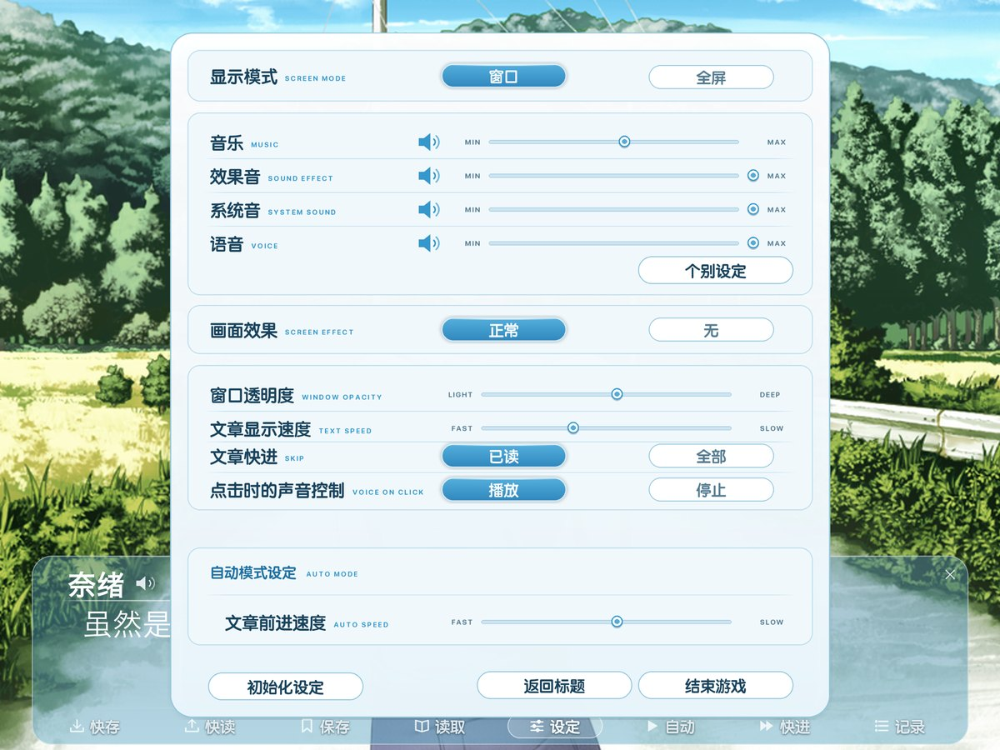
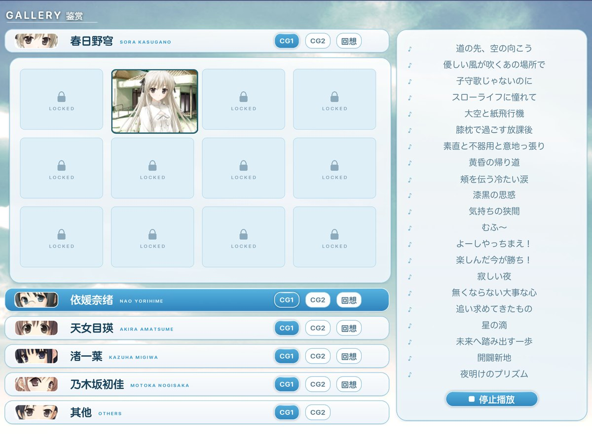
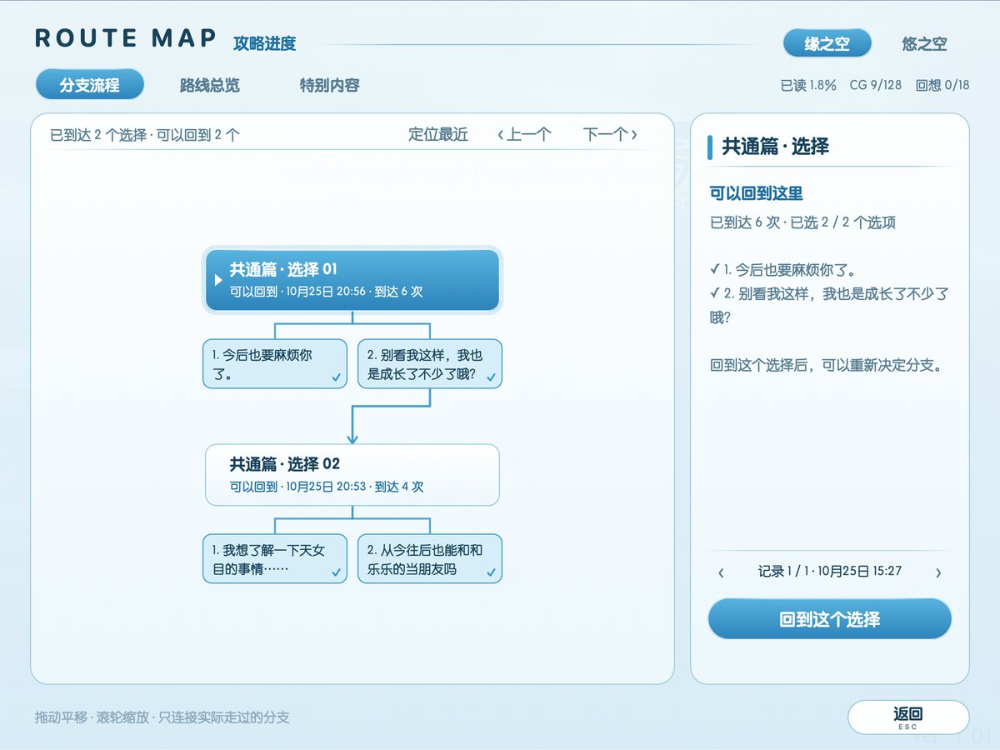
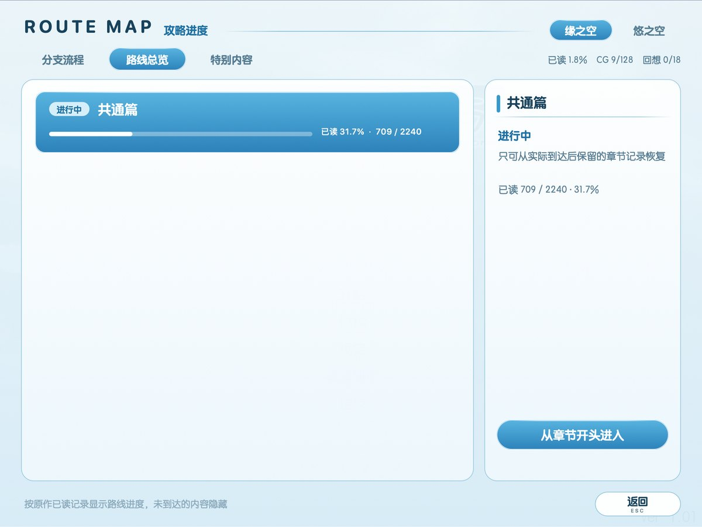
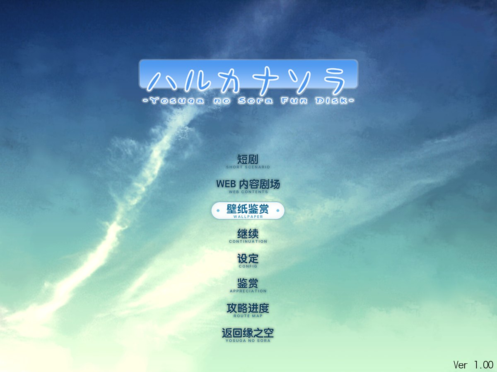
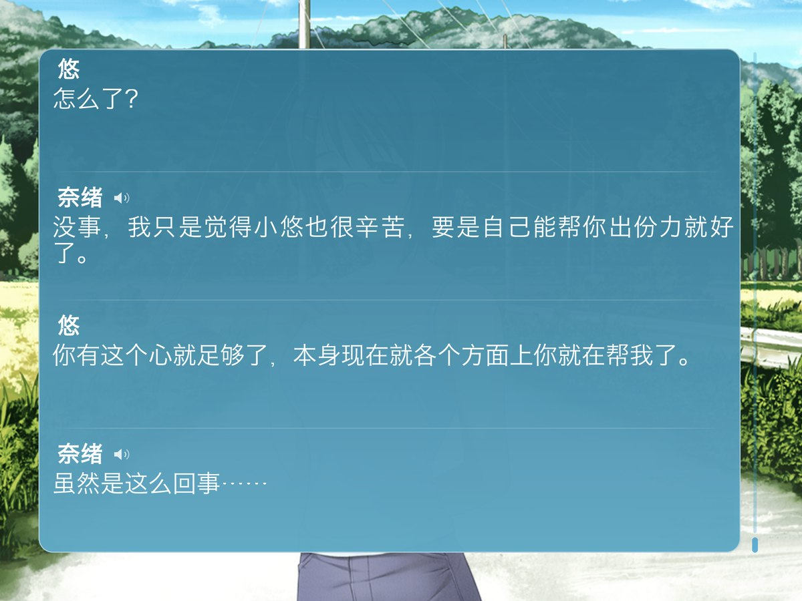

**简体中文** | [English](README.en.md)


# 缘之空 + 悠之空 for macOS

《缘之空》（ヨスガノソラ）与其 Fan Disc《悠之空》（ハルカナソラ）简体中文版的原生 macOS 移植。不用 Wine、不用虚拟机：引擎是官方 EntisGLS4 SDK 的 SDL3 移植，直接在 Apple 芯片上运行原版 Cotopha 脚本。两部作品合在一个 app 里，在缘之空的标题画面点「ハルカナソラ」即可进入悠之空。

> 这是个人存档用的私人仓库。游戏版权归 Sphere 所有，简体中文化归 Sphere 中文化委员会。仓库只含源码与工具，不含任何游戏数据；构建需要你自己的游戏。请支持正版，详见[免责声明](#免责声明)。

## 下载与安装

仓库不提供成品 app（成品包含完整游戏数据）。用你自己的两作目录构建：

1. 准备一台 Apple 芯片 Mac（在 macOS 27 上测试），安装 Xcode 命令行工具和 Homebrew，然后：

   ```bash
   brew install cmake bison webp
   python3 -m pip install pillow numpy fonttools
   ```

2. 取得源码并构建（游戏目录只会被读取，不会被修改）：

   ```bash
   git clone https://github.com/007xf/Yosuga-no-Sora-macOS.git
   cd Yosuga-no-Sora-macOS/source
   ./build.sh "/你的路径/缘之空" "/你的路径/悠之空"
   ```

   第一次会从游戏自身的像素生成四倍高清素材，需要几个小时；之后重新构建只需几分钟。界面用的「圆体-简」是 macOS 可下载字体，脚本会自动取得。

3. 把 `source/build/stage/缘之空.app` 拖进「应用程序」。

如果打开时提示无法验证开发者，到「系统设置 → 隐私与安全性」点「仍要打开」，或者：

```bash
xattr -dr com.apple.quarantine "/Applications/缘之空.app"
```

成品约 9.9 GB（高清素材 5.9 GB，游戏数据 3.9 GB）。存档保存在 `~/Library/Application Support/Sphere/YosugaNoSora/`，删除 app 不会删除存档。

## 截图

| | |
|:---:|:---:|
|  标题画面 |  对白 |
|  选项 |  存档 |
|  设定 |  鉴赏 |
|  攻略进度 · 分支流程 |  攻略进度 · 路线总览 |
|  悠之空标题 |  回看记录 |

截图使用测试存档。

## 更新了什么

### 原生移植

- 官方 EntisGLS4 SDK + SDL3，原版 Cotopha 脚本原样运行，Apple 芯片原生。
- 保持原作 4:3 比例；全屏时两侧加黑边，不裁切、不拉伸。
- macOS 菜单与快捷键：⌘S 存档、⌘L 读档、⇧⌘S/⇧⌘L 快速存读档、A 自动、H 隐藏对白框、⌘Y 回看、⌘→ 快进、⌃⌘F 全屏；⌘, 打开原生设置。

### 「空澄」界面

- 全部界面重新设计成明亮的晴空色调：对白框沿用原作标志性的青蓝渐变并精修成通透的玻璃；存档、读档、设定、确认、选项、鉴赏改为白色磨砂玻璃配深青色文字。
- 界面上的文字全部用圆体与 SF Rounded 以四倍精度绘制，告别原素材放大后的锯齿。
- 鉴赏画面重新排版：角色标签使用原图头像，曲目表用圆角日文字体重排。

### 高清文字与画面

- 对白、人名、选项、存档信息在引擎里以四倍密度重新排字（同一字体、描边与阴影），Retina 屏幕上清晰锐利；逻辑排版与原作一致。
- 4,225 张 CG、立绘、背景与界面纹理均以原像素为依据做四倍插值，不使用生成式重绘，并通过严格的还原度审查（Alpha IoU ≥ 0.97、色差 ≤ 10、SSIM ≥ 0.90）。
- 高清素材以无损 WebP 存储，逐像素与审查通过的 PNG 相同，体积约为 PNG 的一半。

### 攻略进度

- 标题画面新增「攻略进度」，是游戏内页面，参照《白色相簿2》移植版：分支流程、路线总览、特别内容三页。
- 只记录实际到达的选择与实际选过的答案；可以回到到达过的选择重新决定分支，或从章节开头进入。尚未到达的内容不显示。

## Claude 和 ChatGPT 各做了什么

- **Claude**：让 Sphere 2008 年版 EntisGLS 游戏在 SDL3 引擎上运行、存读档界面、两作合并与悠之空入口、窗口与 4:3 适配、打包与图标；1.4 的「空澄」界面、高清文字、游戏内攻略进度页面、无损 WebP 素材存储，以及最终验收与发布。
- **ChatGPT（Codex）**：原生 macOS 外壳（设置、菜单、正常退出）、忠于原像素的四倍高清流水线与审查、选项字体与鼠标输入修正、全屏按键修正、攻略进度的数据与恢复机制（选择快照、跨作品恢复）。
- 两者以交接文档接力，详细记录见 [`source/HANDOFF.md`](source/HANDOFF.md)。

## 仓库内容

| 路径 | 内容 |
|---|---|
| `source/build.sh` | 一键构建：编译引擎、导出界面原图、生成高清素材、打包 |
| `source/vendor/EntisGLS-SDL3/` | 引擎（EntisGLS4 SDK 的 SDL3 移植及本作的移植补丁） |
| `source/mods/src/` | 「空澄」界面：所有界面纹理由代码以四倍精度绘制 |
| `source/tools/` | 归档读写、素材导出、高清流水线、打包与核验 |
| `docs/images/` | 截图 |

## 致谢

- Sphere — 原作
- Sphere 中文化委员会 — 简体中文化
- 理影 / Entis soft — EntisGLS
- nL6DHZc3RhMnC/EntisGLS-SDL3 — EntisGLS 的 SDL3 移植
- SDL、FreeType、libwebp

## 免责声明

- 本仓库仅供个人学习与研究，禁止任何商业用途。
- 游戏内容版权归 Sphere 所有，简体中文化归其译者所有；本项目与他们无关。
- 仓库不包含游戏数据，请使用自己购买的正版游戏构建。
- 如有侵权，请联系删除。使用本项目产生的一切后果由使用者自行承担。
